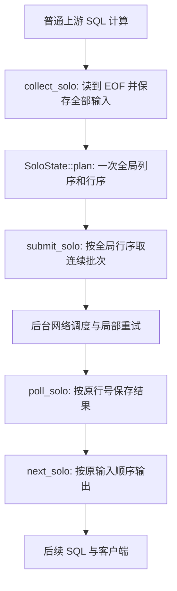

# AI Function、异步 Semantic Operators 与全局 SOLO 维护交接

更新日期：2026-10-12。实现起点：`2ea8cd37c`，`feat(sql): add native FILE and multimodal semantic execution`。本文包含在该基线上新增的原生文本 AI_AGG；保留 2026-10-10 真实视觉模型的部分验收及质量边界。

本文面向接手实现、调试和回归测试的开发者，覆盖 AI Function 异步运行时及全阻塞 SOLO。这里的 SOLO 是数据库端的输入排列算法，不是推理服务端的 KV cache 实现。

## 1. 当前交付状态

| 能力 | 已实现的范围 |
| --- | --- |
| AI_COMPLETE | 每个有效 SQL 输入行对应独立 prompt；逐请求校验、重试、deadline 和取消 |
| AI_EMBED | 当前 SQL batch 内的原生多输入请求；按序列化大小拆分并按响应索引回填 |
| 跨批流水线 | AI_COMPLETE 与 AI_EMBED 共用可配置槽位、逻辑内存预算和后台网络调度 |
| SQL worker 释放 | 符合准入条件的单语句 AI 根算子查询可挂起并从保留状态恢复，不重新执行整条 SQL |
| 全局 SOLO | 收齐当前 AI 阶段的全部输入，完成一次列重排和行重排后才提交模型请求 |
| AI_MAP / AI_FILTER | 显式逻辑和物理算子；独立表达式并发、依赖感知的跨批推进、严格布尔过滤 |
| AI_JOIN | INNER JOIN ON 的显式语义连接；普通 SQL 候选对生成加有界异步判断，不做近似候选裁剪 |
| AI_AGG | 真正跨行的文本聚合；SQL 分组、小组一次调用、有界确定性归约及共享异步运行时 |
| 语义 PX | 经校验的 reduce-transmit / semantic / GI / scan 路径保留任务状态并释放物理 worker；同一查询共享预算 |

旧 AI Function 与 SOLO、AI_MAP / AI_FILTER / AI_JOIN、可恢复 PX 及原生 FILE 实现均已提交；下文保留旧路径的维护约束，不应把旧 SOLO 的单 worker 限制套到新接口上。

已有的 [RUNTIME_TESTS.md](../../../tools/deploy/mysql_test/test_suite/ai_function/RUNTIME_TESTS.md) 是运行契约、测试入口和历史验收记录。本文解释当前架构、维护约束和排障路径；行为或测试变更时，两份文档应一起更新。外层工作区另有历史执行能力补齐计划，但它不是本仓库依赖，也不应被当作最新 SOLO 规范。

关键历史提交：

| 提交 | 用途 |
| --- | --- |
| `2ea8cd37c` | 原生 FILE、多模态异步输入、排序/PX 和真实模型联调修复；当前实现基线 |
| `8dcadbc7c` | 异步 AI_MAP / AI_FILTER 与可恢复 PX；semantic join 的实现基线 |
| `da4ac3f56` | 异步 INNER AI_JOIN、候选合批和连接绑定；FILE 的实现基线 |
| `0532d6e33` | 全局 SOLO 与相关验收 |
| `5bfa9aaed` | 可恢复的多槽 AI 流水线与共享预算 |
| `b30697580` | 共享后台网络调度线程 |
| `183defcac` | AI Function 跨 SQL batch 流水线 |
| `5b2f000bb` | 原生 AI_EMBED batch 与资源测试 |

### 新接口：先理解执行顺序，再看并行

```sql
SELECT id, AI_MAP('classifier', prompt) AS category
FROM inputs
WHERE AI_FILTER('selector', prompt)
ORDER BY id;
```

这里数据库先调用 selector 判断每行，再只对保留下来的行调用
classifier。等第一批 classifier 时，可以继续做第二批 selector；两个互不依赖
的 AI_MAP 也可以一起发出。同一行里 `AI_MAP('b', AI_MAP('a', prompt))`
仍然要先有 a 的结果，但不要求所有批次依次等完。

AI_MAP 返回 LONGTEXT；AI_FILTER 只接受模型返回的 `{"value": true}` 或
`{"value": false}`，转换为 SQL 1/0。错误不能当成 false。`SELECT AI_FILTER(...)`
只是布尔投影，会保留 false 行，因此对应 SEMANTIC MAP；WHERE/HAVING 才把结果
用于筛行。CASE、AND、OR、NOT 继续遵守普通 SQL 的求值边界，不能为了并发提前调用
未选中的分支。

同一个 AI 表达式出现在 HAVING/ORDER BY 和 SELECT 中时，前面的阶段可能只算过
部分行，不能把“这个算子负责它”误当成“所有行都已经算完”。已算过的值随对应行
传递，后面的阶段直接复用；没算过的值只在真正需要的位置补算。尤其是 SELECT
投影要在 LIMIT 之后补算，不能先计算被丢弃行的模型请求或 prompt 参数。

没有 LIMIT 且排序键只包含列、已物化聚合结果或常量时，语义投影先分配在
ORDER BY 之前，避免最终 gather 把所有模型准备集中到 coordinator。计算型排序键
仍保留原来的求值顺序：例如 JSON_EXTRACT 报错时不能先读取 SELECT 中的 FILE。
这不是允许把模型请求下推到 LIMIT、WHERE/HAVING 或聚合输入之前。
普通向量化 full sort 的收集阶段已支持恢复；PX 任务准入复用同一个 SortSpec
能力判断，不能因为计划中存在 SORT 就禁用整个模型等待的 worker 释放。
prefix/local-merge/partition sort、prescan、WITH TIES、近似 Top-K 和 Top-N filter
仍受保护；强制 dump 或已经 spill 的运行时也不会借此扩大挂起边界。

实现使用显式 shared/carried 元数据：只有声明过的语义结果可以携带内部
“尚未请求”的 NULL 标记，正常 AI_MAP/AI_FILTER 结果不会是 SQL NULL。false 和
空字符串都是有效的已完成值；内部标记不能作为查询输出。依赖这些结果的 CPU
prompt 配方及条件 fallback 不当成完整输入列传递，而是在消费者的语义运行时中
按需重算。批次已初始化状态与每行完成位分开，补算一行不能清掉其他行的缓存。
完整 CASE/OR 条件已经算完，不代表它跳过的 CPU 分支也算完了；条件本身可以输出，
但被跳过的分支仍要保持延迟求值。

首版模型和配置必须是静态值；prompt 可以包含普通 SQL 运算、位置参数 AI_PROMPT
或前一个 AI 的结果。新接口不支持结构化全局 SOLO，也没有未接入算子时的同步
completion 退路。AI_FILTER 使用原有原生 `response_format.json_schema`：
固定必需布尔字段 value、禁止额外字段、strict=true。只有精确大小写的 Schema
是保留键；AI_FILTER 拒绝该键，匹配的原生格式和调用者非空名称可以原样使用，
冲突格式报错。AI_MAP 的 Schema 只是原有 provider 配置透传，不是新增简写。

#### AI_JOIN：先跑通全部候选对，再谈缩小范围

```sql
SELECT l.id, r.id
FROM left_inputs l
JOIN right_inputs r
  ON AI_JOIN('matcher', '判断两侧是否描述同一个实体',
             l.description, r.description)
ORDER BY l.id, r.id;
```

签名是 `AI_JOIN(model, rule, left_input, right_input[, options])`。首版只允许
INNER JOIN 的 ON 条件，不作为 SELECT/WHERE/HAVING/GROUP/ORDER 的通用函数，
也不支持 outer/semi/anti join。模型和 options 静态；规则是普通 SQL 字符串
表达式，左右输入可为字符串或 JSON。每个输入必须只引用连接一侧的非空列集合，
另一个输入引用另一侧；纯常量输入或单个输入跨两侧引用明确不支持。左右参数
可反向填写，但参数角色不会随优化器交换 build/probe 侧而交换。

规划层新增 SEMANTIC JOIN，保留候选生成器两侧的表集合和原始
模型/规则/左右输入表达式。首版对包含 AI_JOIN 的语句保守禁止 join elimination：
主键 self-join 虽然可以在关系上无损消除，但不能在语义 lowering 之前丢掉候选对
边界。其他普通候选连接算法仍可使用。物理上采用组合实现：普通二元 SQL JOIN 流式生成
候选行对，专用语义连接阶段复用现有异步运行时分批判断，不额外收齐整个
笛卡尔积。普通 SQL 条件可以减少候选；除此以外不做 ANN、blocking、级联或
文本去重。因此没有普通连接条件时仍可能有 N×M 次判断，重复文本的不同输入行
不会合并，多对多匹配保留 SQL 重复行语义。

普通 NLJ 可能每次只返回一对行，即使 EXPLAIN 显示 ROWSET=16。语义连接会先把
这些碎片合并到配置的批大小，再占一个流水线槽，不能让两个槽退化成只有两个
模型请求。末尾、上游等待或查询内存压力允许输出不足一批的已拥有候选；所有
已保留数据仍参与预算，不能通过预先发送模型请求绕过额度。

模型 prompt 是包含 rule、left、right 的 JSON 对象：字符串作为 JSON 字符串，
JSON 输入保留其类型，不把普通字符串当模板展开。实际需要求值时，SQL NULL
规则/输入报错，不能转换为 false；普通 SQL 短路可以避免未选中的调用。
输出沿用 AI_FILTER 的严格布尔 value schema，默认名称 ai_join；匹配的调用者
response_format 和名称可保留，Schema 保留键及格式冲突会明确报错。options
仅配置模型请求，不宣称支持尚未实现的连接策略。

异步批次、依赖、在途额度、保留内存、取消、deadline 和 rescan 清理复用现有
语义底座；候选 JOIN 自己的 workarea 与语义保留缓冲分别计账。该版本不扩大
任意二元 JOIN 的 PX 挂起准入，因此不能把跨批 HTTP 重叠当作整条 SQL 释放
worker 的证据。测试入口是
[test_semantic_join.py](../../../tools/deploy/mysql_test/test_suite/ai_function/test_semantic_join.py)，
契约与验证记录见
[Semantic Join Baseline](../../../tools/deploy/mysql_test/test_suite/ai_function/RUNTIME_TESTS.md#semantic-join-baseline-2026-10-09)。

rescan 要在调用框架的 child rescan 之前恢复原始输入 frame、取消旧任务和清空槽位。
只在 inner_rescan 中恢复已经太晚：框架先重置子树，再把旧匹配行的 frame 盖回去，
可能让后续轮次的行 ID 错位，即使 prompt 和模型结果仍正确。

#### 所有权、资源与恢复

- 每个执行上下文拥有自己的 SQL frame 和 readiness 列表；不同 PX 上下文不共享
  frame，只共享同一 execution ID 的 SemanticQueryBudget。
- 每个算子最多保留 `ai_pipeline_slots` 批输入。全查询最多在途
  `ai_pipeline_slots × 不同语义调用数` 个 client-batch，不乘 DOP。
  一个 completion client-batch 里仍是多条独立 HTTP 请求，不要混淆这两个数量。
- 保留的行、结果、prompt、模型名、静态配置和网络缓冲参与逻辑内存计账。
  配置每轮提交只准备一次，不按行保留重复 JSON；临时表达式/JSON、allocator
  开销等不构成全 RSS 限制。原有实例总预算及 4MiB 请求、8MiB 响应、
  64MiB client-batch 边界不变。
- SQL worker 会回收同一执行上下文内所有语义阶段已完成的任务，释放在途额度，
  但不会在回收回调中求值其他算子的 SQL frame。否则下游批槽已满时，上游已经
  返回的请求可能钉住全部额度，让下游一直等到 deadline。
- 若首次输入在上游批次仍被当前调用栈持有时放不进查询内存预算，则明确报配额
  错误，不等待当前调用栈无法释放的内存。这里是保守的配额策略，不是所有内存
  压力下都会自动降低并发。
- 不能在任意父算子中直接上传 pending。open 总是禁止挂起；未经验证、局部进度
  仍在栈上的父算子保守等待。这样的查询仍能跨批发请求，但不能据此宣称整条 SQL
  都会释放 worker。
- PX 首版只放行向量化 reduce-transmit → 连续 semantic map/filter → 可选 GI →
  scan/expr-values。rescan、sampling、shuffle/hybrid 和不安全 join/receive/
  blocking 祖先不放行。每个 PX pool 最多 64 个保留记录，不另建推理调度线程；
  挂起不 close、不报完成、不归还逻辑准入，真正结束才释放所有权。
- WHERE 语义过滤要在 LIMIT/Top-N 下推之前变成独立节点。语义 pair predicate
  不下推成可变 NLJ 参数。预取前保存整个 child datum frame，而不是只保存已返回的
  行：prefix sort 等父子组合可能仍持有后面的输入尾部。

新增源码入口：

| 入口 | 职责 |
| --- | --- |
| [ob_expr_ai_semantic.cpp](../../../src/sql/engine/expr/ob_expr_ai/ob_expr_ai_semantic.cpp) | 接口类型、严格布尔约束、静态参数和无同步退路 |
| [ob_log_semantic.cpp](../../../src/sql/optimizer/ob_log_semantic.cpp) | 语义计算归属；[规划入口](../../../src/sql/optimizer/ob_select_log_plan.cpp) 负责阶段放置 |
| [ob_semantic_op.cpp](../../../src/sql/engine/basic/ob_semantic_op.cpp) | 输入/结果所有权、按需表达式依赖、发送/轮询/跨批输出 |
| [ob_transform_join_elimination.cpp](../../../src/sql/rewrite/ob_transform_join_elimination.cpp) | 语义 lowering 之前保留 AI_JOIN 的二元候选边界 |
| [ob_semantic_runtime.cpp](../../../src/sql/engine/basic/ob_semantic_runtime.cpp) | 查询共享预算、失败传播、readiness 与安全挂起范围 |
| [ob_px_worker.cpp](../../../src/sql/engine/px/ob_px_worker.cpp) | 保留 PX 上下文、逐 slice 恢复 TLS、取消和真实结束 |
| [ob_px_task_continuation_store.h](../../../src/observer/omt/ob_px_task_continuation_store.h) | 有界记录、ready-only 驱动、lease 与 shutdown |

map/filter 的真实私有 SQL 测试已经验证 8 分区、PARALLEL(4) 下同一 execution ID 的四个 task、
多个实际 CPU thread、预算不随 DOP 放大、精确结果及调用次数。所有响应被扣住时
PX active slice 归零，另一条并行查询复用相同物理线程；取消、deadline、provider
错误后的连接/配额恢复，以及正常零退出码 shutdown 也通过。native 调度器压力测试
与这份 SQL 证据要分开记录，HTTP 并发和 EXPLAIN DOP 本身不是多 worker 证明。

2026-10-08 的 map/filter 基线验证通过：39 项新接口 SQL 契约、26 项关系组合回归、8 项真实 PX 回归、
原有 105 项 AI Function SQL 契约，以及两个独立正常 shutdown。另有 11 项语义
fixture 自测、120 次预算/挂起范围/并发 registry 回收/完成额度回收检查、78 项
native 收集场景通过；PX 生命周期的 9 项用例重复 20 次及 ASan/UBSan 另有记录。
此环境无法启动 TSan，不能算作 TSan 通过。测试只使用私有数据库和 loopback
mock，没有调用真实模型或证明 SemBench 加速。

2026-10-09 的 join 首版在最终 Debug 构建上重新验收通过：45/45 AI_JOIN SQL、
14/14 join fixture 自测、39/39 map/filter SQL、26/26 关系组合、9/9 真实 PX、
105/105 旧 AI Function/SOLO SQL、140 次原生资源/绑定/发现/挂起范围检查、
78 项原生收集场景，以及旧流水线和 semantic PX 两个独立正常零退出码 shutdown。
9 项 PX 中新增的 join 用例验证同一 execution ID 的四个 task、多个实际 CPU
thread、全查询 32 个 held HTTP 请求上界、256 次精确候选判断和 128 对输出；
它没有扩大任意 join 子树的 worker 释放准入。其余 8 项继续验证 map/filter
的挂起和真实线程复用。

目前做的是正确的阶段规划和执行底座：仍未实现包含模型延迟、费用、选择率和质量
目标的 semantic CBO，也未实现近似检索/级联、低复杂度语义连接或专用集合级
语义 aggregation。新增 AI_JOIN 是保留完整候选的执行基线，不应被称为新的
低复杂度连接算法。map/filter 测试记录见
[运行契约](../../../tools/deploy/mysql_test/test_suite/ai_function/RUNTIME_TESTS.md#asynchronous-semantic-operators-2026-10-08)，
join 的新契约与验证记录见上面的 Semantic Join Baseline。

## 2. 如何使用和确认执行路径

前提：模型和 endpoint 已按现有机制注册，连接拥有相应权限。以下表名、列名和模型名是示例，不应直接对生产数据执行。

```sql
SELECT id,
       AI_COMPLETE(
         'my_completion_model',
         AI_PROMPT('Classify the text using the named fields.',
                   JSON_OBJECT('category', category, 'text', prompt))) AS answer
FROM inputs
ORDER BY id;
```

- 两参数 `AI_PROMPT` 的第二参数是 JSON 类型，且该表达式直接作为受支持的顶层 `AI_COMPLETE` 输入时，选择全局 SOLO。无需单独的字段换序开关。
- 对同一查询执行 `EXPLAIN`，应出现 `AI SOLO GLOBAL`。常规跨批路径显示 `AI FUNCTION PIPELINE`，二者不是同一规划策略。
- `AI_PROMPT(template, string_args...)` 和普通字符串 prompt 保持旧语义。不能对位置模板自动交换参数，也不能把已存储的结构化 prompt 当作普通列传入就期待自动启用 SOLO。
- 任务说明、模型和可选配置必须为静态常量。字段对象非空，各行字段名相同；字段值可以为 JSON null、数值、字符串及嵌套值。对象本身为 NULL、数组或标量则不合法。
- `JSON_OBJECT` 中只放真正需要模型看到的字段。用于结果对应的 `id` 可以留在 SQL 投影中，不必加入 prompt；引入唯一字段可能降低可共享前缀。

序列化后的 prompt 是固定任务说明加一个按所选列序输出的合法 JSON 对象。字段名始终与值绑定，一行一个 prompt，重复行仍保留。字段换序可能影响模型回答，不承诺与旧 prompt 逐字等价。

### SQL 支持边界

支持单个顶层 completion 和单 worker 的普通上游过滤、表达式、连接、聚合。全量是“该 AI 算子的全部子输入”，不一定是整张基表；本版不提供任意多 AI 阶段执行计划。

不支持的形态包括动态任务说明/模型/配置、多个 AI 调用、AI 依赖排序、标量执行、LIMIT、DISTINCT、窗口函数、集合操作、子查询及 parallel/exchange 计划。保留下来的 HAVING、GROUP BY、JOIN 等上游表达式中不得夹带额外 AI 调用。结构化输入不支持时应报错，不能悄悄退回逐行模型调用。AI_EMBED、AI_RERANK 不接入 SOLO。

`rowsets_max_rows=1` 不等于标量执行，仍可能选择向量化的全局算子。检查计划和实际执行入口，不要仅凭批大小判断是否走 SOLO。

## 3. 源码导航

下表中的符号适用于基线版本；修改后优先按符号定位，不依赖历史行号。

| 入口 | 维护职责 |
| --- | --- |
| [ob_expr_ai_prompt.cpp](../../../src/sql/engine/expr/ob_expr_ai/ob_expr_ai_prompt.cpp) | `calc_result_typeN`、`eval_ai_prompt`：区分旧字符串参数与新的具名字段对象，构造 prompt object |
| [ob_expr_ai_complete.cpp](../../../src/sql/engine/expr/ob_expr_ai/ob_expr_ai_complete.cpp) | `prepare_input`：公共输入解析与结构化输入的执行路径约束；保留旧 scalar/batch 语义 |
| [ob_select_log_plan.cpp](../../../src/sql/optimizer/ob_select_log_plan.cpp) | `candi_allocate_ai_func`、`check_solo_input`、`check_solo_plan`：识别模式、检查 SQL 和上游计划准入 |
| [ob_log_ai_func.cpp](../../../src/sql/optimizer/ob_log_ai_func.cpp) 与 [ob_log_ai_func.h](../../../src/sql/optimizer/ob_log_ai_func.h) | AI 表达式的 producer 归属、逻辑属性、模式标记和计划名称；防止子算子提前求值 AI |
| [ob_static_engine_cg.cpp](../../../src/sql/code_generator/ob_static_engine_cg.cpp) | 将逻辑算子的 SOLO 标记传入物理 spec |
| [ob_ai_func_op.cpp](../../../src/sql/engine/basic/ob_ai_func_op.cpp) 与 [ob_ai_func_op.h](../../../src/sql/engine/basic/ob_ai_func_op.h) | `SoloMemory`、`SoloState`、全量收集/规划/发送/回填、普通流水线、恢复与清理 |
| [ob_ai_func_utils.cpp](../../../src/sql/engine/expr/ob_expr_ai/ob_ai_func_utils.cpp) | provider 请求构造、`AIFuncBatch`、completion/embedding 结果解析与映射 |
| [ob_ai_func_client.cpp](../../../src/sql/engine/expr/ob_expr_ai/ob_ai_func_client.cpp) | HTTP 状态、逐请求重试、后台网络调度、准入、共享预算、取消和 deadline |
| [ob_sql_session_mgr.cpp](../../../src/sql/session/ob_sql_session_mgr.cpp) | 挂起期间 session 缓存的生命周期，避免活跃语句借用的 schema guard 被定期回收 |

改动 worker 挂起协议时，继续沿 `RequestAwait` 的授权、保留 processor、恢复和释放调用链检查，不能只在 AI 算子里返回普通 `OB_EAGAIN`。

## 4. 全阻塞执行流程与所有权



1. `collect_solo()` 完整读取 child，校验固定参数、字段名和每行输入；保存后续输出需要的原始行与序列化字段值。数据使用受预算约束的 `ObChunkDatumStore` 和 `SoloMemory`，不能借用会被下一批覆盖的 datum/frame。
2. `SoloState::plan()` 对全量字段做精确字典编码。初始所有行属于同一前缀类；每轮按不同 `(当前前缀类, 候选列值)` 的数量选列并更新前缀类。最后按选定列序进行字典序行排序，原行号作为最终决胜项。
3. `submit_solo()` 只在以上两阶段成功后运行。从全局行号排列中取连续部分，构造 prompt 并交给现有客户端。HTTP 批次是资源调度单位，不是 SOLO 规划窗口。
4. `poll_solo()` 检查全部活动槽位。响应通过“发送位置 -> 排列索引 -> 原行号”回填；完成槽位可释放并被复用，不应因为原输出队首未完成就永久占住槽位。
5. `next_solo()` 只输出原输入顺序中连续已就绪的结果。它会保留尚不能输出的结果，可能产生队首等待和额外内存占用；无 `ORDER BY` 的 SQL 仍不承诺自然行序。
6. `reset_pipeline()`、`inner_close()`、`inner_rescan()` 和 `destroy()` 负责取消并释放状态。先终止网络对内存的引用，再释放请求、行存储和预算，重复清理应安全。

算法比较的是实际 JSON 序列化值字节，不是 SQL collation。不能用不区分大小写的相等比较合并模型实际看到的不同字符串。当前算法精确执行贪心选列，不代表在所有列排列中取得全局最优；不要把采样、近似 NDV 或按窗口重排作为无语义变化的替换。

### 异步运行时边界

- SQL 执行侧负责表达式求值、权限/endpoint 解析和结果回填；后台网络线程不应承担依赖原 session/eval context 的整套表达式执行。
- 网络调度器拥有 64 个活动 batch 槽，和 `ai_pipeline_slots`、单 batch 内 HTTP 请求数不是同一个概念。默认 completion 批内并发跟随该批有效请求数。
- 授权的等待通过 `RequestAwait` 保留执行上下文并释放原 worker，随后在原 worker 恢复。不是整 SQL 重试、线程池包裹阻塞等待或通用协程；有界保留容量和同步回退仍存在。
- 查询的同一个绝对 deadline 覆盖准备、准入、网络、重试退避和恢复。SOLO 收集与规划也需检查取消/超时。
- 请求提交顺序不能保证服务端 prefill 顺序，取消本地连接不能保证远端停止推理或计费。请求结果不确定时不能承诺 exactly-once。

## 5. 预算、配置与失败边界

| 项目 | 当前值或策略 |
| --- | --- |
| `ai_pipeline_slots` | 默认 2，范围 1–1024；控制算子在途 batch 槽位，在 open 时读取 |
| `ai_pipeline_memory_limit` | 默认 64MiB，范围 1MiB–1TiB；算子逻辑预算，在 open 时读取 |
| `ai_pipeline_total_memory_limit` | 默认 1GiB，范围 1MiB–1TiB；实例动态共享逻辑额度 |
| SOLO 收集与规划 | 最多使用本地预算的一半，为执行保留余量 |
| SOLO 执行 | 保留输入、结果及在途客户端共同受完整本地预算和实例额度约束 |
| 客户端大小 | 单请求序列化后 4MiB、单响应 8MiB、单客户端 batch 64MiB |
| 磁盘溢写 | 未实现；不自动切换为窗口或抽样模式 |

调试会话可使用：

```sql
SHOW VARIABLES LIKE 'ai_pipeline%';
SET SESSION ai_pipeline_slots = 2;
SET SESSION ai_pipeline_memory_limit = 67108864;
```

这些是逻辑保留字节额度，不是进程 RSS 硬上限。部分 JSON/表达式临时内存、allocator slack、curl 内部状态等不在完整计账范围内。实例额度按实际保留量共享，不是每条查询预留其配置上限。

收集/规划超限会在零模型请求时失败。网络阶段的请求、响应和待输出结果仍可能超限并取消本地任务，不能保证预留一半后任意输出都能容纳。原始行溢写到磁盘也不能自动解决编码矩阵、分组哈希表和结果存储的内存问题。

## 6. 不能改坏的契约

- **发送屏障**：child 未读完或全局规划失败时，目标 AI 的 HTTP 请求数为零。末行非法不允许前面的行已经发送。
- **输入与输出对应**：不漏行、不隐式去重、不让完成顺序变成结果对应关系；重试只针对失败请求，不重新发送成功行或重跑查询。
- **表达式边界**：AI producer 在本算子，准入覆盖所有保留的上游表达式。不能仅检查 SELECT/WHERE 而遗漏 HAVING/GROUP BY/JOIN。
- **所有权**：跨等待的输入、请求、响应和映射不能依赖临时栈或已复用 frame；取消完成前不能释放被网络引用的内存。
- **额度回滚**：失败、取消、rescan、close 和 destroy 只归还自己持有的额度，不清空其他槽位或其他查询的计账。
- **恢复语义**：只有经过授权的挂起才能保留请求状态；异常不能被吞掉并留下永远无法唤醒的 request。
- **session 生命周期**：挂起仍是活跃语句。定期 schema/config 缓存回收不能破坏其借用对象；相关空闲回收保持在 `SESSION_SLEEP` 条件下。
- **凭据与诊断**：认证由提交侧完成。默认不记录密钥、完整 prompt 或模型响应；不要为排障将凭据写进示例或测试日志。

## 7. 构建与验收命令

以下命令从 seekdb 仓库根目录运行。当前开发环境是 Linux；本工作区的 Python 为 `/volume/xicksys/.venv/bin/python`。迁移环境时需重新准备编译依赖和 PyMySQL，不能假设绝对路径存在。

### 构建

```bash
source .vscode/seekdb-env.sh
bash .vscode/build-debug.sh
```

该工作区脚本生成 Debug 二进制并刷新 clangd 编译数据库。二进制位置为 `build_debug/bin/src/observer/seekdb`。本地 `.vscode` 配置不应被当作任意克隆都具备的可移植发布接口。

### 最小 SOLO 检查

```bash
source .vscode/seekdb-env.sh
/volume/xicksys/.venv/bin/python tools/deploy/mysql_test/test_suite/ai_function/test_runtime_contracts.py \
  --binary "$PWD/build_debug/bin/src/observer/seekdb" \
  --case test_solo_global_layout_and_original_row_mapping \
  --case test_solo_invalid_final_row_submits_nothing \
  --case test_solo_conditional_prefix_selection \
  --case test_solo_unsupported_shapes_and_field_changes_submit_nothing
```

### 完整交付检查

```bash
source .vscode/seekdb-env.sh
/volume/xicksys/.venv/bin/python tools/deploy/mysql_test/test_suite/ai_function/test_runtime_contracts.py --self-test
/volume/xicksys/.venv/bin/python tools/deploy/mysql_test/test_suite/ai_function/test_runtime_contracts.py \
  --binary "$PWD/build_debug/bin/src/observer/seekdb"
/volume/xicksys/.venv/bin/python tools/deploy/mysql_test/test_suite/ai_function/test_runtime_resources.py \
  --build-dir "$PWD/build_debug"
/volume/xicksys/.venv/bin/python tools/deploy/mysql_test/test_suite/ai_function/test_runtime_contracts.py \
  --binary "$PWD/build_debug/bin/src/observer/seekdb" --shutdown-test
git diff --check
```

测试入口：[SQL 契约](../../../tools/deploy/mysql_test/test_suite/ai_function/test_runtime_contracts.py)、[原生测试 runner](../../../tools/deploy/mysql_test/test_suite/ai_function/test_runtime_resources.py)、[原生测试实现](../../../tools/deploy/mysql_test/test_suite/ai_function/test_runtime_resources.cpp)。

SQL runner 使用私有临时数据库、Unix socket 和 loopback HTTP mock，不连接现有调试数据库或真实模型；需预留数 GiB 临时磁盘和至少 2GiB 内存。原生 runner 链接当前 Debug 对象，不自动重编业务代码，因此必须先构建，避免验证旧对象。`--shutdown-test` 是独立检查，正常停机使用 `SIGUSR1`；本项目的 `SIGTERM` 路径会强制终止，不能代替正常停机验收。

### 已有验证证据

此前基线的历史记录是 Debug 构建、105/105 SQL 契约、5 项夹具自测、原生资源测试和独立正常停机检查通过；105 项中有 10 项 SOLO 契约。记录日期为 2026-09-29，代码于 2026-10-08 提交。2026-10-08 的交接撰写本身没有重跑这些测试；2026-10-09 的重新验收见第 1 节，不能把不同版本的历史记录混作当前证据。

SOLO 覆盖全局跨批排列、末行非法零请求、条件前缀选列、JSON 类型/转义/大小写/重复行、乱序完成与局部重试、连接聚合、非法形态、额度复用、取消/超时/错误清理及 worker 释放。原生 rescan 证据是空输入反复扫描和诊断路径，不等于保留数据或在途请求时的完整 rescan 证明。

## 8. 常见排障路径

| 现象 | 优先检查 |
| --- | --- |
| 没有 `AI SOLO GLOBAL` | 第二参数是否真是 JSON 类型，是否直接传入 AI_COMPLETE；固定参数、顶层投影、向量化和 SQL/计划准入是否满足 |
| 收集阶段 4019，mock 收到零请求 | 本地半预算、实例剩余额度、字段和旁路输出列尺寸；不要改成提前发送来绕过限制 |
| 执行阶段 4019 | JSON 转义后的请求大小、原始响应与保留结果、输入和网络共享占用；槽位数不是唯一决定因素 |
| 长时间没有首条结果 | 全量上游、规划耗时，以及原输出队首是否仍未完成；不是所有等待都发生在模型端 |
| 网络已有响应但查询不恢复 | `can_resume` 是否检查所有活动槽位，是否卡在网络准入；检查 RequestAwait 授权、deadline 和 processor 生命周期 |
| 多批次挂起十秒后出现 4014 | session checker 是否回收了活跃语句借用的 schema cache；重跑长期挂起回归 |
| 有更多槽位但并发没升高 | 64 个后台活动 batch、半预算预取条件、待准入状态、服务端排队，以及当前批有效行数 |
| 计划里有重排但没有加速 | 服务端 prefix cache 是否启用、实际 prefill 次序、token/块对齐、缓存容量与驱逐；先分开数据库准备耗时和推理耗时 |

`collect_solo()` 的 `AI SOLO global plan ready` 日志记录收集/规划时间、行数、所选列及逻辑分配峰值等信息。其内存峰值不是整个查询/进程 RSS，日志也不是已测得真实缓存命中的证明。

回归夹具中常见的误判：未使用右表的 LEFT JOIN 可能被优化器消除，测试额外 AI 的 JOIN 条件时必须让目标计划真正保留它；测试内存压力时，不要把 LONGTEXT 外部 payload 大小直接当作算子保留字节；检查 worker 释放必须观察请求线程和独立控制查询，不能以 `future.wait` 或异步函数名为依据。

## 9. 未完成事项与接手顺序

以下均不是已交付能力：

1. 真实模型的缓存命中、computed/cached token、端到端速度和输出质量验证。比较相同输入、相同模型与配置下的无重排、仅列重排、行列重排；区分字符/字段代理、token 前缀、KV block 命中和实际耗时。
2. 磁盘溢写和更大输入集。需共同设计原行、编码/计数和待输出结果的存储，保持 EOF 后才发送的屏障，不能只给行存储打开 spill 就认为问题解决。
3. 多 AI 阶段、并行计划、动态配置和更多 SQL 形态。扩展前明确求值与副作用边界，不要简单删除准入判断。
4. 更完整的异常证据：所有算子/JSON 分配失败、保留数据与在途请求的 rescan、ASan/LSan/TSan、最大槽位和挂起容量压力。
5. 租户公平和更精确的内存/服务端指标。当前实例逻辑总额不是租户配额，也不是严格 RSS 限制；HTTP 发送顺序不是服务端调度控制。

建议接手者先用第 2 节确认路径，再构建并执行最小 SOLO 检查，随后根据修改范围运行完整验收。变更输入契约、预算或调度策略时，先添加能失败的对应测试，再改实现；交付时记录实际提交、运行命令、测试结果及未验证范围，不覆盖旧的历史证据。

## 10. 原生 FILE 与多模态维护契约

FILE 保存有类型的外部引用，不保存图片/音频内容，也不是 JSON 的别名。
`TO_FILE(path_or_json)` 只做格式校验和词法规范化，不做文件 I/O；
`FILE_URI(file)` 返回规范 URI，`FILE_META(file)` 返回版本化 JSON 元数据。
这三个函数对 SQL NULL 返回 NULL。来源支持绝对本地路径、`file:///` 和
预签名 HTTPS URL；数值回环 HTTP 仅用于私有测试。没有原生 S3/OSS 凭据、
stage 或上传接口。外部文件不参与数据库 MVCC，
删除引用也不会删除文件。

```sql
CREATE TABLE image_data (id BIGINT PRIMARY KEY, image FILE NOT NULL);
INSERT INTO image_data VALUES (1, TO_FILE('/data/animals/zebra.png'));
SELECT id FROM image_data
WHERE AI_FILTER('vision_model', ('Does this image contain a zebra?', image));
```

模型通过现有 CREATE_AI_MODEL JSON 声明
`"input_modalities":["text","image"]`，或增加 `"audio"`；没有该字段仍是纯文本。
模态名称区分大小写，必须包含 text，不允许空数组、重复、未知值或非字符串。
只有 completion 模型可声明媒体输入。声明不是数据库自动发现的模型能力，
也不能证明 endpoint 真正支持相应输入与严格布尔 schema。

本地读取需要管理员设置 GLOBAL-only 的 `ai_media_root`，远程读取需要
GLOBAL-only 的 `ai_media_remote_root`；两者分别默认空值禁止读取，
普通会话不能扩大读取范围。`ai_media_max_bytes` 默认每媒体 2 MiB，
`ai_media_parallel` 默认查询内四个本地/远程加载准入，可按会话调整。
引用构造/元数据投影不需要启用读取。越界、符号链接、非普通文件、缺失、
损坏、超限、读取期间变化或元数据不匹配必须报错，不能降级为文字或 false。

输入可以是 FILE，或最多 64 项的有序 tuple：首项文字，后续文字/FILE。
普通字符串即使像路径也仍是文字。内部 AI_INPUT 把 tuple 降为临时 JSON 配方，
`$seekdb_ai_input` 是内部保留标记；不能把它当作 FILE 的存储格式或公开稳定接口。
配方保留次序，按需接回原生编码的 FILE 引用。NULL 错误在实际语义调用处报告，
未选中的 CASE/AND/OR 分支不能因为加载媒体产生副作用。

### 2026-10-12：预签名对象存储 URL 异步读取

首版复用对象存储预签名 GET URL，不在 seekdb 中保存 AK/SK 或生成签名。
管理员显式允许一个完整 origin 和路径前缀，必须以 `/` 结尾且没有 query：

```sql
SET GLOBAL ai_media_remote_root = 'https://media.example/bucket/images/';
SELECT id, AI_MAP('vision_model', ('Describe this image.', image))
FROM image_data;
```

非法 prefix 在 `SET GLOBAL` 时就拒绝；空值或 `DEFAULT` 关闭远程来源。
普通用户不能设置 GLOBAL policy，也不能通过 SESSION override 扩大范围。
未启用或不匹配的本地/远程来源沿用 `OB_OP_NOT_ALLOW`，不能按不支持的功能
静默跳过。新增配置也接入旧库的安全默认值和 primary-only 持久化迁移。

应用通过绑定参数将预签名 URL 写入 `TO_FILE`/FILE 列；也可通过版本化 JSON
descriptor 提供 MIME、size_bytes 和 `sha256:<hex>` 内容校验。HTTPS scheme
和 DNS host 必须小写，显式端口保留且不能含前导零。URI 的 escaped path
和 query 原样保存、原样发送，不能规范化或重排签名参数。不同签名 URL
是不同缓存键；仅同一查询内相同完整 URL/version 共享读取。`object_version`
仍表示内容 hash，不是对象存储 ETag/versionId；若读取特定云对象版本，
应由预签名 URL 包含对应 versionId。签名在执行读取时必须有效。
URI 仍限制为 4096 字节，FILE binary layout/version 不变。FILE 结果现在支持
表达式动态缓冲，避免长 URL 或 size/hash 元数据超过 128 字节保留缓冲时误报 4013。

远程访问范围与本地 root 独立；仅启用远程来源时本地 root 可以保持空值。
拒绝 userinfo、fragment、dot traversal、路径中 escaped slash/backslash、
控制字符、未编码空格和非 ASCII 字节；这是一组明确限制的 URL 子集，不是任意
HTTP 浏览器。仅允许严格的数值回环 HTTP `127.0.0.1`/`[::1]`，不能用
`localhost` 或非回环明文 HTTP 访问远端。HTTPS 使用系统 CA 并强制证书和
主机名验证；禁止重定向、环境代理、cookie 和自动内容解压。下载只发 GET，
不发 HEAD，不新增下载重试，HTTP/传输错误直接报错；云端压缩对象暂不支持。

独立的 `SemanticFetch` 单线程 curl multi 执行器推进非阻塞网络 I/O，
最多 64 个活跃下载、128 个等待任务；依赖 curl 的 asynchronous DNS 支持。
慢下载不占用原有四个本地读取/校验/编码 worker。完整下载成功后，按有界
队列交给同一个媒体容器校验、内容 hash 和 Base64 阶段；不是逐块上传或
数据库内 pixel decode。查询内的 media parallel 覆盖排队、下载和准备阶段。
未知长度和 chunked 响应同样受实际字节上限约束，声明大小与 Content-Length
不一致必须失败。请求逻辑开销、原始 buffer、增长时的新旧 buffer 和编码结果
纳入共享预算；原始下载 buffer 在完成/失败时释放，不能留在结果缓存中。
这仍是逻辑预算，不是 curl 内部或进程 RSS 的硬上限。

只等待媒体、尚未提交模型请求时，共享 readiness 也检查 query/session kill，
恢复原 SQL worker，由正常状态检查传播错误并取消媒体；后台线程不求值 SQL frame。
取消/deadline 会主动从 multi 移除在途下载，不能等服务端发完响应才退出；
查询销毁和正常停机必须 drain 下载及后续准备任务。媒体加载器的错误诊断不打印完整 URL
或 descriptor，防止泄露签名 query；但 FILE_URI/FILE_META、SQL 字面量、
审计记录和应用日志仍可能包含它。应按短期凭据保护 FILE 列，并优先使用绑定
参数，不把有效签名写入代码、文档或测试日志。

本轮最终 Debug 构建和编译信息刷新通过（2977 source commands）。
远程 native 12 项契约在三个独立进程轮次全部通过，SQL 10/10、
fixture 9/9 通过；覆盖逐字节签名 query、四种媒体、4096 字节 URL、
MIME/size/hash、chunked/未知长度、错误状态、TLS 拒绝、代理/重定向禁用、
四个挂起下载不阻塞本地 worker、共享准入、预算释放、取消和 deadline。
SQL 还验证 vision MAP → text AI_AGG → post-MAP 的依赖和精确请求数。
独立正常停机契约保持 SQL client、四个 GET 和全部服务端 gate 未释放，
要求 SIGUSR1 十秒内零退出码，并观察到四个下载 socket 关闭。

缺失远程变量的 private catalog 模拟通过 primary/standby 两项重启契约：
primary 持久化默认值和 history，standby 只发布内存安全默认值、不写 catalog；
再次重启保留已有 policy、模型和 FILE 数据。当前完整 policy 的 standby 重启
也通过。旧 pre-FILE binary 的历史升级验收没有在本轮重跑，不能把上述模拟
称为新的跨版本二进制升级证明。相关回归通过 native codec/storage/local media
10/6/29 项各三轮、标准 Bazel codec target、12 项 local FILE SQL（含实际 PX）、
6 项 text MAP/FILTER、2 项 JOIN、3 项 AGG 和 4 项实际 PX 取消/deadline。
本地 fixture 27/27 也通过。

测试说明与命令见 [RUNTIME_TESTS.md](../../../tools/deploy/mysql_test/test_suite/ai_function/RUNTIME_TESTS.md)。
全部媒体是生成数据，存储/模型端是私有回环夹具；未验证真实 S3/OSS/MinIO
账号互通、真实模型/GPU 性能或完整 SemBench。当前仍整对象下载后准备、
沿用 SQL slot/Dispatch 屏障；没有 fetch-to-provider streaming、跨查询缓存、
原生对象存储 SDK、签名续期或资源感知的全查询 DAG。AI_AGG 仍只接收文本，
图像可先由 vision MAP 生成文字，再进入异步归约；包含 AGG 的 SQL 仍为 serial。

共享 media runtime 随查询预算存活，后台任务拥有读取/编码缓冲，不访问 SQL frame。
文件准入和 logical-wave task credit 分开；前一个 HTTP 子批次仍被扣住时，
同一 wave 中后来准备好的行也能继续提交。每个 Dispatch 拥有独立 body arena、
client batch 和行位置映射；其结束只释放对应缓冲和字节计账，不能释放整个 wave
的 credit 或清掉其余配方。所有 Dispatch 合计在途行数不超过已拥有的 SQL 批大小，
完整 wave 结束后才释放输入 arena 和逻辑 credit。media ready 只表示完成，
构造请求前还必须检查 result、MIME 和 base64，失败不能变成空图片请求。
须先取消/排空网络任务，再释放 FILE handle；
execution state 也须先释放 media runtime 再释放预算，否则 weak registry 和计账滞留。

首版明确只支持 provider=openai：图片为 `image_url` data URI，音频为
`input_audio` base64/format，不做 ASR。文本协议兼容不等于媒体兼容。
AI_JOIN 以明确左右标签保持参数角色，旧文本/JSON JOIN prompt 不变。
4 MiB 请求等原有限额仍按真实序列化报文检查，base64 和中间副本也需预算。

FILE 整值不开放 key/index、比较、排序、GROUP/DISTINCT、算术或拼接；
URI/META 投影才是普通 SQL 值。非键值传递、NULL、COUNT 和兼容 CASE/COALESCE
保留类型。MySQL 协议以已有 wire type 输出 JSON 文本引用，不发送未知类型码
或原生内部编码。FILE 数据要求支持该类型的服务端，不能把本轮检查当作旧二进制
降级或混合版本滚动升级的证明。

旧库升级有两层：schema fetch 只对缺少的四项媒体变量（包括远程 root）提供明确记录的安全默认值，
不能对任意缺失变量悄悄补默认，也不能覆盖已有 policy。系统表 schema 发布之后，
可写 primary 才用一个事务持久化缺少的变量及 history 并刷新；不能在系统表可解析
之前执行这段 SQL。随后初始化 DDL/max-ID 服务，使用初始化后的 UTC time-zone map
只添加模型的 input_modalities 列，在确认两张表的列 ID/default 后才标记 ready。
standby/write-fenced 启动不做本地 catalog 迁移；primary 提升及 committed retry
在打开正常写入前检查持久化媒体变量和模型列，缺失则返回 OB_SCHEMA_EAGAIN，
不能为迁移暂时打开写入。

原生 FILE 首轮 Debug 构建上通过：64/64 FILE SQL、25/25 fixture、自建旧库到新库的
实际升级及二次重启、9 组 codec、4 项 storage/wire 与 5 种 microblock 编码、
29 组异步 loader、12 组输入/provider、13 组模型/default 重复 3 次、
12 张类型矩阵和 12 项 parser AST。minor 验收使用定向 TABLET_ID freeze 并确认
新的 MINI/MINOR 完成记录；major 同样确认完成后再重启，未把 freeze 命令成功
或 skip 当作落盘证明。首轮多模态 PX 使用无最终排序的查询，要求四个真实 task
和多个 CPU thread；DOP 标签本身不能证明 AI 调用分布在 PX worker。
另通过 2 项只读 catalog 重启契约：旧 standby 不持久化缺失的媒体变量/模型列，
新 standby 保留已有 policy、mask/history 与 FILE 值，普通写入仍被拒绝。
codec 也通过仓库标准 Bazel test；5 项受控 Dispatch 场景再次通过。

首轮同一 binary 的旧回归也通过：39 map/filter、26 composition、45 join、9 PX、
105 旧 AI Function/SOLO、140 次 native 资源检查、native collection，以及两个
正常 SIGUSR1 零退出码 shutdown。复制追平后的 standby activation 端到端仍不在
本地升级验收范围内；未到达 catalog 检查的 timeout 不能算作提升 write-fence
测试通过。

后续增量 Debug 构建已通过 68/68 FILE SQL、27/27 fixture、39 map/filter、
30 composition、45 join、15 项实际 PX、150 次 native 资源/SortSpec 能力检查
和 native collection；105 项旧 AI Function/SOLO 也在该增量构建上重新通过。
新排序用例保持 SQL 的复合键/字符串排序、完整 FILE
值和精确请求计数；同时要求四个实际 task、多个 CPU thread、单任务默认
32 个扣住的请求，以及扣住所有回复期间零活动 PX worker slice。嵌套任务仍按
真实语义调用数共享预算，排序不能提前发送依赖任务。
新增缺失文件哨兵验证 LIMIT 丢弃行不加载、计算型排序错误先于 FILE demand。
取消、deadline、provider 错误后仍可在同一连接恢复。

另新增 [held FILE 正常停机入口](../../../tools/deploy/mysql_test/test_suite/ai_function/test_file_shutdown.py)：
coordinator 和带 full sort 的实际 PX 分别启动独立数据库，保持 SQL 客户端和
媒体 HTTP gate 打开，直接 SIGUSR1，要求服务端在十秒内零退出码停止，SQL 客户端
收到关闭错误；不能先断客户端、释放模型回复或强杀后声称正常停机通过。
两种实际场景均已通过，不再仅借用纯文本 shutdown 或 native loader teardown
作为 FILE SQL 停机证据。

真实文本模型入口为
[test_semantic_live.py](../../../tools/deploy/mysql_test/test_suite/ai_function/test_semantic_live.py)，
只允许显式指定的 loopback endpoint/model，并使用新的私有数据库。
vLLM 0.22.1 + Qwen3-4B-Instruct-2507 上已通过严格 schema 预检和六项实际
MAP/FILTER/JOIN/关系组合 SQL；65 项 DB-free runner 检查也通过。
这是小型合成标签的真实推理正确性证据，不是 SemBench 质量或速度报告。
当时视觉 9B 权重不完整，四项 opt-in FILE 实模契约尚未运行；
2026-10-10 的独立 Qwen2.5-VL-3B 实验见下文，不能混作该文本验收的一部分。

该联调发现 JSON_EXTRACT 会把等待中的 OB_EAGAIN 改成 JSON 错误，
JSON_UNQUOTE/JSON_PRETTY 又改成 5874，JSON_VALID 则错误地提前返回 false。
已修复这些等待状态的传播，JSON_VALID 的子表达式错误也不再变成成功的 false；
已完成的非法 JSON 内容仍按原语义返回 false，CASE 未选中分支仍不求值。
新增四项组合回归后完整 composition 为 30 项，105 项旧 SQL 再次通过；
完整 PX 为 15 项，排序 JSON 投影验证了请求数、四个 task 和挂起时 worker 释放。
四格式 FILE 输入经过 MAP 后再 JSON_EXTRACT/JSON_UNQUOTE 的投影也通过。

本地 SemBench 实验已新增显式 opt-in 的 `semantic` 模式，旧默认模式、历史
SQL 和历史结果未替换。真实 Qwen3-4B 上，ecomm_q1/ecomm_q5 各四行、
ecomm_q7 两个合格商品形成四个有序候选对，legacy 与原生语义版本均完成，
三项最终有序 bag/hash 一致。Q7 每个版本恰好四次模型调用，结果保留两个自匹配。
69 项实验生成/比较/默认配置契约通过。这里不比较阶段答案/token 等价性，
不计算加速比，也不能推广为完整 SemBench 的质量/性能报告。
临时 vLLM 服务在验收后已正常零退出码停止，已确认它的 API/engine 进程退出、
独占的回环端口关闭和 GPU 资源归还；没有留下需要用户手动关闭的测试服务。

### 2026-10-10：真实视觉 FILE 实验与质量边界

Qwen2.5-VL-3B-Instruct 已完整下载到本机
`/volume/models/data/Qwen2.5-VL-3B-Instruct`。固定官方 revision
`66285546d2b821cf421d4f5eb2576359d3770cd3`，14 项文件 hash/大小、
两片 safetensors、824 项 tensor index 及离线 CPU processor 均通过校验。
模型采用 Qwen Research License，仅用于非商业研究/评估；商用需另行授权。

单张 RTX A6000 上使用现有 vLLM 0.22.1、BF16、eager、FlashAttention，
context 4096、最多两个 sequence、显式 1 GiB KV、每请求最多两图/零视频、
processor pixel 范围 3136..262144，关闭 prefix cache 和 multimodal processor cache。
临时服务为 `http://127.0.0.1:18081/v1`，模型 ID
`seekdb-file-validation-vl3b`；结束前显存快照为 9,101 MiB，不是峰值或吞吐测量。
当前实现基线的 Debug 构建和 65 项 live runner 自测通过，生产代码未因实验改变。

| 独立标注的实验 | 实际结果 |
| --- | --- |
| 128x128 红图，`Is this image predominantly red?`，期望 true | 直接严格 schema 预检、六项文本/关系组合 SQL 和四项 FILE SQL 全部通过。 |
| 同图，`Is this image predominantly blue?`，期望 false | 直接预检回答 true，`model-quality`、退出码 3；该任务未进入 SQL。 |
| 独立问题 `Does the image have a blue background?`，期望 false | 预检及 FILE MAP/FILTER 投影/WHERE 三项通过；FILE 与文字答案 JOIN 对 right=`"false"` 返回 false，而匹配应为 true，退出码 3。 |
| 红/蓝双图是否同色 | 直接 red/red 通过，但 red/blue 错答 true；预检退出码 3，四有序候选对的 FILE/FILE SQL 验收未运行。 |

另用同一份权重做 native Transformers 5.10.2、BF16、greedy SDPA 对照，
不经过 vLLM、SQL 或 guided JSON decoding，复现了原负例和异色双图的错误。
自由回答颜色为 red 正确；仅在独立诊断中把图片放到原负例问题之前，
两种 backend 都能回答 false。该现象指向模型/提示布局敏感性，
目前没有媒体传输或 SQL 实现错误的证据。没有把诊断成功覆盖失败、
改写 SQL 的有序 `(text, FILE)` 输入、修改人工 ground truth 或放宽 schema；
结构化输出正确不代表语义答案正确。

结论仅是**真实视觉链路部分验收**，不是完整多模态质量通过。
自然图像数据、audio、完整多模态 SemBench、加速比、向量候选召回和
SOLO/prefix-cache 收益均未验证；历史 mock/PX 验收没有在本次完整重跑。
实际响应、失败和 native 对照保存在会话实验记录中。
私有数据库/媒体已清理，临时 vLLM API 通过 SIGTERM 零退出码停止，
engine 退出、18081 端口释放、GPU 无 compute process 且显存回到 15 MiB；
离线权重保留，不需要用户再手动关闭服务。
详细边界见 [真实视觉实验记录](../../../tools/deploy/mysql_test/test_suite/ai_function/RUNTIME_TESTS.md#real-image-experiment-2026-10-10)。

验证入口为 [FILE SQL/fixture 契约](../../../tools/deploy/mysql_test/test_suite/ai_function/test_file_runtime.py)
、[codec/storage/loader runner](../../../tools/deploy/mysql_test/test_suite/ai_function/test_file_native.py)
和 [有序输入原生契约](../../../unittest/sql/engine/test_semantic_input.cpp)。
构建、持久化重开、实际 PX、取消/停机及旧语义回归需分别记录；
mock 成功不等于真实模型质量、完整 SemBench 可运行性或加速已验证。

## 11. 原生文本 AI_AGG（2026-10-12）

这不是把每行 AI_MAP 的结果拼起来，也不是用 GROUP_CONCAT 绕过普通聚合绑定。
AI_AGG 是 `ObAggFunRawExpr`，由逻辑 GROUP BY 生成专用 `SEMANTIC AGG`
物理算子。可以与 COUNT/SUM/AVG/MIN/MAX 同时计算，普通算术仍由 SQL
聚合处理器完成，不让模型代替数据库做精确统计。

```sql
SELECT department,
       AI_AGG('summarizer', feedback,
              'Summarize recurring concerns and preserve disagreements.',
              '{"context_window":8192,"tokenizer":"byte_bpe",
                "template_tokens":256,"max_output_tokens":512,
                "max_partial_bytes":2048,
                "provider_options":{"temperature":0}}') AS summary,
       COUNT(*) AS row_count
FROM feedbacks
GROUP BY department;
```

执行契约：

- 输出为 nullable、UTF8MB4_BIN LONGTEXT；非 NULL 的空输入字符串也是一行。
  SQL NULL 输入跳过，重复行保留。空 scalar 或全 NULL 组返回 SQL NULL；
  空的分组输入返回零行。这些组不调用模型。模型成功返回空字符串时，
  输出是 `''`，不是 SQL NULL。
- 一个组的完整输入能放下时，seal 后只发一次 DIRECT 请求，直接返回答案。
  大组扫描时按完整行形成 EXTRACT 请求；EXTRACT 整理相关证据，
  COMBINE 合并相邻证据，FINALIZE 最后按用户 instruction 回答。
  组内归约采用固定相邻二叉树和确定性的 EOF 尾部折叠，不由 HTTP 完成顺序
  改变合并图。确定性针对同一输入流，不承诺无 ORDER BY SQL 的扫描顺序。
- 依赖已经满足的子树立即合并，不等待整层的全部叶子。
  不同组、不同聚合及上下游 MAP/FILTER 共享异步调度；
  单个输入行的 group/binding 游标在等待和重试时保留，普通聚合不会重复累计。
  ready 判断使用完成计数，避免大量组在每次 poll 时被从头遍历。
- 分组使用 SQL hash/collation/NULL 比较和 owned key，而不是把键序列化后
  按字节判断相等。不能把 `a` 和 `A` 在大小写不敏感分组中拆成两组。
- 首版整个含 AI_AGG 的语句使用 serial 策略，保守阻止聚合消除、下推及大部分
  rewrite；这不是语义成本优化器。SQL worker 仍可在安全的祖先路径上挂起；
  不安全路径保留栈等待，不改成同步模型调用。

### 显式上下文预算，不猜 tokenizer

语法为 `AI_AGG(model, input, instruction[, options])`。首版执行需要第四参
显式给出 `context_window` 和 `tokenizer: "byte_bpe"`；三参虽然可绑定，
但不会从模型名猜配置，也不会无预算执行，而是零请求报错。
只支持静态 model/instruction/options、文本或 SQL NULL 输入，
以及 OpenAI-compatible completion endpoint。直接 FILE、JSON、ROW、
动态配置、AI_AGG 的 DISTINCT/ORDER BY/window、ROLLUP、PX partial/final
和 spill 尚不支持；同一专用聚合里的普通 DISTINCT/ordered aggregate
也被保护性拒绝。

预算按**完整序列化 user prompt 的 UTF-8 bytes**作为所声明 byte-BPE
tokenizer 的保守 token 上界，不使用“字符数除以四”：

```text
user_prompt_bytes <= context_window - template_tokens
                     - max_output_tokens - system_prompt_bytes
```

`template_tokens` 默认 256，但调用者负责给出实际 chat framing 的安全上界。
引擎会设置 provider 的 `max_tokens`，并计入 instruction、JSON escaping、
phase 和 source_count 的 framing。这不是接入了通用精确 tokenizer，
也不是保证错误的调用者 tokenizer/framing 声明仍能安全运行。
单个输入行、COMBINE 或 FINALIZE 的完整 prompt 放不下都显式报错，
不截断材料或忽略证据。

`max_partial_bytes` 默认 1024，限制**所有阶段输出**，包括 DIRECT/FINALIZE。
`max_calls` 默认 4096、`max_levels` 默认 32，按每个组的每个 AI_AGG 控制归约图；
transport retry 仍使用共享 client 的策略，不另生成一个归约节点。
`provider_options` 仅放行 temperature/top_p/top_k/seed/presence_penalty/
frequency_penalty，不能覆盖 model/messages/stream/n/stop/response_format/
max_tokens。options 文本最多 64 KiB，未知键和无效预算拒绝。

全查询的 task credit 为 `ai_pipeline_slots × 全查询语义表达式数`，
该聚合 stage 的并发上限为 `ai_pipeline_slots × 本 stage 的 AI_AGG 数`，
不是按组无限乘开。group/controller/keys、普通聚合的 held arena、
frame、请求及响应 arena 和 wire buffer 纳入逻辑预算；
部分 allocator 在分配后校验，不宣称 RSS 硬上限，也没有外存退路。

只有恰好一个 choice、`finish_reason="stop"`、无非 NULL refusal、
string content 的完整响应才成功。截断、拒绝、非法 envelope、quota、
deadline 和取消都失败并清理任务，不能返回部分成功或把错误当 NULL。
这项严格 plain-text 解析是 AGG opt-in，旧 MAP/COMPLETE 的接口没有借此改变。

实现入口为 [SQL binding](../../../src/sql/engine/expr/ob_expr_ai/ob_expr_ai_agg.cpp)、
[归约控制器](../../../src/sql/engine/basic/ob_semantic_aggregation.cpp)、
[物理聚合算子](../../../src/sql/engine/aggregate/ob_semantic_aggregate_op.cpp)
和 [SQL/mock 契约](../../../tools/deploy/mysql_test/test_suite/ai_function/test_semantic_aggregate.py)。
具体命令及本轮验收证据见
[Native Semantic Aggregation](../../../tools/deploy/mysql_test/test_suite/ai_function/RUNTIME_TESTS.md#native-semantic-aggregation-2026-10-12)。
真实模型的事实保留、质量、GPU 利用率和 SemBench 性能仍需单独评估；
source_count 是 SQL 可信元数据，不是模型答案质量的证明。

本轮已通过 Debug 构建、27 项 AI_AGG SQL/mock 契约、12 项归约原生契约
重复三轮（36 次）、15 项共享资源原生契约重复三轮（45 次）和 3 项 fixture
self-test。另跑通 5 项既有语义组合及 5 项 MAP/FILTER 运行时回归。
3 项受控并发/子树推进/逆序完成测试另重复三轮，9 次全部通过。
AI_AGG 私有数据库正常停机退出码为零，未发现语义资源泄漏日志。
没有启动 GPU 或真实模型服务，也没有完整重跑历史 FILE/PX/legacy suites。

## 12. 可选的语义算子延后求值（2026-10-13）

```sql
SELECT /*+ OPT_PARAM('enable_semantic_lift', 'true') */ a.id, b.category
FROM semantic_inputs a
JOIN selected_ids b ON a.id = b.id
WHERE b.enabled = 1 AND AI_FILTER('classifier', a.prompt);
```

默认关闭；`'true'` / `'false'` 不区分大小写，其他值明确返回
`OB_INVALID_ARGUMENT`。这是普通 JOIN 规划之后的放置规则，还不是把模型延迟
纳入代价的 CBO。执行树从下往上看：先扫描、先 JOIN 删掉不需要的行，
再执行位于 JOIN 上面的 `SEMANTIC FILTER/MAP`。

首版只交换直接相邻的语义阶段与普通 INNER HASH/MERGE JOIN，支持左右两侧，
也可逐层越过连续的合法 JOIN。未开启函数缓存时，必须用已有 FD、等价集合和常量信息证明
**另一侧**在完整等值键上唯一，保证一条语义输入最多产生一条 JOIN 输出；
不要求外键证明一定匹配，因为删掉不匹配行就是优化目的。只接受同类型直接列
的普通 `=`，不接受 null-safe 等值或计算键，不能为了少调用模型破坏 bag 语义。

Nested Loop、带参数/相关依赖、late materialization、shared/carried 语义值、
两侧或输入子树还有语义阶段、JOIN 依赖模型值、以及可能失败的普通表达式均保守
拒绝。单个语义配方内的 CASE/AND/OR 守卫不拆开，也不移动。允许直接列/常量、
简单布尔和比较、已知无损的隐式转换、原生 tuple 输入和直接 `TO_FILE` 配方；
显式 CAST、JSON 提取、UDF、易变表达式不在首版范围。普通 scan filter 仍在原处。
不越过 LIMIT/Top-N、GROUP、DISTINCT、outer/semi/anti JOIN 或子查询边界，
不移动 AI_JOIN 的 candidate-pair 边界，不放松 AI_AGG 的改写保护。
已有投影 MAP 在 LIMIT 后按需执行的行为不变。

移动在全部 lowering、HAVING/投影共享值登记之后，只对关系 CBO 已经选出的计划
执行；其余候选计划先移除，避免改坏共享的逻辑子树。不能在第一次递归 lowering
时就移动，否则尚未登记的 carried 值或后续 AI_JOIN candidate 边界会被绕开。
移动仍发生在表达式 producer 分配和 codegen 之前。JOIN 通过原 join path 恢复
FD/排序/分布属性并更新子节点成本；语义阶段对新的 JOIN 输入重算属性，
必要列由正常的表达式分配穿过 JOIN，查询任务数仍使用共享计数；发生变化的
上层节点也刷新属性/成本，不把普通 JOIN 当作单子节点继承 FD。
遍历中显式保护 `SEMANTIC JOIN` 的直接 candidate JOIN。
`EXPLAIN` 用 `semantic_placement=LIFTED, crossed_inner_joins=N` 标记应用；
尝试但拒绝时打印 `KEPT` 和 `lift_stop_reason`。内部 `OPT_TRACE` 启用时同样记录
原因；它不是 `information_schema.OPTIMIZER_TRACE` 的 JSON 接口，公开验收以
`EXPLAIN` 为准。
估计行数/耗时仍是关系优化器的估计，不是实际模型次数或推理延迟。

开启后明确减少未匹配行的模型/媒体 demand：这些行不发模型请求、不做对象 GET，
也不再触发其模型/媒体专属校验错误；留下的行仍严格校验和传播失败。
单独开启上提不是把错误变成 false，也不是缓存模型答案。异步 slot/Dispatch 屏障和
整对象下载行为没有借此改变。

真实私有 SQL 基线已验证：关闭时 `JOIN -> SEMANTIC FILTER -> SCAN`，
开启时 `SEMANTIC FILTER -> JOIN -> SCAN`，不仅比较计划标签，还检查节点祖先关系、
模型 payload 和最终 SQL 元组。唯一 HASH JOIN 的左右两侧均为 100 → 10 次；
较大输入为 1000 → 100 次；MERGE JOIN 为 12 → 2 次；连续两层 JOIN 为
24 → 4 次且显示两个 crossings。本地/远程 FILE 均为 12 → 3 次模型调用，
远程对象 GET 同样为 12 → 3 次，被过滤对象零 GET，留下的损坏对象仍报错。
确定性夹具下最终 SQL 元组完全一致。不能据此宣称真实模型质量不变、
GPU overlap 已最大化或完整 SemBench 已提速。

实现入口为 [semantic lowering](../../../src/sql/optimizer/ob_select_log_plan.cpp)、
[逻辑语义阶段](../../../src/sql/optimizer/ob_log_semantic.cpp)
和 [OPT_PARAM 注册](../../../src/sql/resolver/dml/ob_hint.cpp)。
专项入口为 [语义放置 SQL/mock 契约](../../../tools/deploy/mysql_test/test_suite/ai_function/test_semantic_lift.py)，
运行命令和验收证据见 [RUNTIME_TESTS.md](../../../tools/deploy/mysql_test/test_suite/ai_function/RUNTIME_TESTS.md#opt-in-semantic-late-evaluation-2026-10-13)。

最终 Debug 构建通过 29/29 项专项 SQL 和 18/18 项 fixture self-test。
无 ORDER/LIMIT 的 shared FILTER/HAVING 仍在 JOIN 下，不依赖 before-sort
那次 lowering 才能识别共享；普通 GROUP/DISTINCT 上层的刷新用例也要求
100 → 10 次请求和完全相同的分组/去重结果，不能用计划标签代替调用数验收。
既有定向回归另通过 composition 10、MAP/FILTER 9、AGG 5、AI_JOIN 4、
local FILE 6、实际 PX 4、remote demand/取消 2，共 40 项。没有重跑全部历史
native/legacy suites。私有进程正常停止并清理资源；本轮未提交代码，
未连接真实云存储或模型/GPU 服务。

## 13. 查询级函数缓存与缓存支撑的贪心上提（2026-10-13）

```sql
SELECT /*+ OPT_PARAM('enable_semantic_cache', 'true')
           OPT_PARAM('enable_semantic_lift', 'true') */
       a.id, b.category
FROM semantic_inputs a
JOIN selected_rows b ON a.id = b.input_id
WHERE b.enabled = 1 AND AI_FILTER('classifier', a.prompt);
```

两个开关都默认关闭，值必须为带引号的 true/false（不区分大小写）。只开缓存也
有效，不要求同时上提。缓存覆盖模型和 options 为静态常量、输入布局可证明为
纯文字的 MAP/FILTER/AI_JOIN；FILE、未知 JSON 输入布局和动态模型/options
不使用这版缓存。AI_AGG 不缓存答案，AI_JOIN 不改变放置位置，也不放松其直接
candidate JOIN 的保护。

同一节点、同一次执行的所有语义算子、批次和本地 PX worker 共享缓存。第一次
实际 demand 时捕获并冻结该模型参数的模型/端点元数据。调用键包含函数种类、
模型绑定、生效配置和带长度边界的有序输入；JSON 配置按对象键排序，保留标量
类型，文本按实际字节比较，不按 SQL collation 合并。JOIN 的 rule/left/right
以及文字 tuple 的分段边界不会因拼接后相同而混用结果。查询结束释放，不跨
查询、租户或服务器共用答案；不是跨节点的 exactly-once 协议。

缓存同时保存 PENDING 和完成状态。同键的进行中请求只产生一个 producer，其他
行订阅同一结果，不额外占网络 wave credit。请求及其 allocator 由查询级
dispatch 持有，不借用 producer Slot/表达式 frame/worker session；协调者的
执行上下文持有查询 lease，避免本地 PX producer 完成后丢失缓存。
完成收集接入现有查询级轮询，即使后续是未缓存的语义/聚合算子也可以推进。
SQL 行和 JOIN 候选不去重，复制行只是复用同一个答案。

布尔响应使用与未缓存路径共用的严格解析器，校验通过才发布。失败保存为
FAILED future 并向订阅者传播，不变成 false/空字符串。输入照常在 lookup 前
校验，未 demand 的守卫分支不创建缓存记录，也不照搬 PLOP 的 NULL 免调用
约定。开启缓存明确采用“本次执行同一有效调用复用一次采样结果”的契约；
不保证关闭缓存或另一次真实模型执行的逐字答案一致。

永久键、结果和模型/配置 allocator 页占用上限为
`ai_pipeline_memory_limit` 的一半，同时计入原有查询预算。活动请求和响应
buffer 也计入同一预算。缓存不淘汰已完成答案后重新推理；超限明确报资源错误，
不能静默绕过或等待永久缓存自行释放。需要保存更多不同输入/答案时增大既有
查询内存限制，或关闭缓存。这版没有磁盘 spill。

上提仍只跨原先允许的普通 INNER HASH/MERGE JOIN；关闭缓存时继续要求另一侧
完整等值键唯一。开启缓存且阶段内每个语义调用都可可靠缓存时，允许跨会复制行
的 JOIN。保留其他求值守卫、共享值、依赖模型输出、易变/可能失败的普通配方、
子查询及 LIMIT/GROUP/DISTINCT 等边界。遍历重复到固定点，能合法上提就上提，
不比较关系/模型成本，不引入成本 DP、embedding proxy 或行间结果发布。
缓存配方的字符串比较额外接受 resolver 为常量文字引入的 UTF8MB4→binary
隐式 collation 转换，仍要求类型不变、长度不缩短，使 `AI_MAP(...) = 'keep'`
可以移动；不放开显式 CAST、任意比较转换或缓存关闭时的旧配方检查。

`EXPLAIN` 新增 `function_cache=LOCAL_QUERY_TEXT, memoized_calls=N`，表示绑定的
可缓存调用点数，不是实际推理次数；原 placement/crossings 标记继续保留。
INFO 查询摘要统计 distinct keys、ready hits、进行中合并、实际提交的不同调用和
缓存字节，不打印 prompt 或凭据；HTTP 重试单独计数。
源码入口为 [查询缓存](../../../src/sql/engine/basic/ob_semantic_cache.cpp)、
[查询共享运行时](../../../src/sql/engine/basic/ob_semantic_runtime.cpp)、
[异步语义执行器](../../../src/sql/engine/basic/ob_semantic_op.cpp) 和
[放置规则](../../../src/sql/optimizer/ob_select_log_plan.cpp)。
专项入口为 [缓存 SQL/mock 契约](../../../tools/deploy/mysql_test/test_suite/ai_function/test_semantic_cache.py)，
运行方式见 [RUNTIME_TESTS.md](../../../tools/deploy/mysql_test/test_suite/ai_function/RUNTIME_TESTS.md#query-function-caching-and-cached-greedy-lifting-2026-10-13)。

最终 Debug 构建及缓存专项 16/16 SQL（无 skip）、27/27 fixture self-test 通过。
非唯一 HASH/FILTER 为 12→6（仅缓存）→3（缓存+上提）；MAP 比较配方为
12→3，MERGE 为 12→6→2，连续 JOIN 为 24→4 且两个 crossings，跨算子
相同 FILTER 为 70→1。SQL bag/值均与确定性基线一致。持有响应时同批/跨批
重复 MAP 只提交两个不同键；本地 PX 有四个实际 task/thread，但只提交一个
同键模型请求，未释放响应时取消返回 1317，随后独立恢复通过。quota 返回 4019，
不重新推理；布尔/provider 错误同键只请求一次且原错误传播。下次查询重新取答案。

原生输入/共用解析器 15/15、旧上提 29/29 和定向 default-off runtime 9、
composition 10、实际 PX 4 另通过，共 52 项既有 SQL 回归。没有重跑全部历史
legacy suites，也没有真实模型/云存储/GPU 性能证据。普通 LIMIT drain 不会
关闭其语义 child，本轮没有为了测试而改动该行为；专项没有独立证明提前关闭
producer 后 FAILED future 的消费时序。所有私有 DB/mock 均已清理；该缓存版本
已提交为 `465bbab6c`。

## 14. 实验性 FILTER embedding proxy V0（2026-10-13）

这是显式选择的近似执行，不是结果等价的上提优化。低相似度也可能满足主模型
判断，因此可能漏行；不提供自动阈值校准或召回率保证。默认关闭，不做高分直接
接受，不新增逻辑算子或成本模型。

```sql
SELECT /*+ PARALLEL(1)
           OPT_PARAM('enable_semantic_cache', 'true')
           OPT_PARAM('enable_semantic_lift', 'true')
           OPT_PARAM('enable_semantic_proxy', 'true')
           OPT_PARAM('semantic_proxy_model', 'embed_model')
           OPT_PARAM('semantic_proxy_query', 'database deadlocks')
           OPT_PARAM('semantic_proxy_threshold', '0.25') */
       id
FROM documents
WHERE AI_FILTER('judge_model',
               AI_INPUT('Does this text discuss database deadlocks? ', content));
```

`semantic_proxy_model` 必须指向已注册的 dense embedding 模型；主判断模型
仍为 completion 模型。开启时 model/query/threshold 三个参数都必须提供，
threshold 必须为带引号、有限且位于 [-1,1] 的数字。示例 0.25 不是推荐阈值。
必须同时显式开启函数缓存，上提开关可选。检索描述由用户填写，不从 prompt
自动猜测，也不把完整判断指令和正文一起作为文档 embedding 输入。

V0 只支持一个语义阶段中的单个正向文本 FILTER，形如
`AI_FILTER(常量模型, AI_INPUT(固定文字指令, 文本列))`，options 仍可为常量。
共享/投影 FILTER、NOT/OR/CASE/比较配方、额外语义调用、FILE、AI_AGG 以及
并行/exchange 计划均明确报不支持。正文为空明确报错；正常输入校验，包括
SQL NULL 行为，仍在缓存 lookup 前发生，不静默绕过 proxy。

执行顺序为普通关系计算及已有放置规则 → 函数缓存命中/进行中合并 → 唯一
miss 的异步批量 embedding → cosine 路由。每条查询绑定只提交一次检索描述
embedding，其他批次等待其结果；文档只取 AI_INPUT 的第二段正文。
分数严格小于 threshold 时发布 `{"value":false}`；相等或更高时仍请求原
AI_FILTER 模型。主模型 prompt/options 不变，响应继续通过共用严格布尔解析器。
原行位置和 SQL bag 保留，不能依靠相似度排序后的数组下标恢复行。

评分复用 seekdb 原生 raw cosine 内核及其 CPU 分派；构建和硬件允许时使用
AVX2/AVX512，不再单独维护点积/范数循环，也不替换成归一化的 SQL similarity
接口。保留维度、有限值、非零输入和有限结果检查，内核错误直接传播，不回退
到自写标量评分。分数仍限制在 [-1,1]，支持非归一化向量，严格小于阈值才拒绝。
原生浮点累加顺序可能使阈值附近出现微小差异，不保证与旧循环逐位一致。
本次只复用向量计算，不读取已有 VECTOR 列，不建立或使用 ANN 索引，也不减少
embedding 请求数量。

缓存绑定额外包含 proxy 模型、检索描述和阈值，近似拒绝不混入普通模型调用的
缓存身份。两个模型/端点都在 demand 时捕获并由查询持有。查询向量计入缓存
永久配额，临时 JSON/向量解析、请求和响应计入原查询预算；文档向量评分后
释放。错误数量/维度、非数字/非有限/零向量、provider 错误和资源不足明确
传播，不当作低分 false，也不回退为成功结果。

EXPLAIN 新增 `embedding_proxy=REJECT_ONLY, approximate=true, threshold=...`。
原 INFO 缓存摘要另含 query/document embedding 输入数、proxy 拒绝/转交的
不同调用数；submitted 主模型调用数不含直接拒绝，不是 HTTP 重试次数。
不打印 prompt、检索原文、向量或凭据。

源码入口为 [向量解析/评分](../../../src/sql/engine/basic/ob_semantic_proxy.cpp)、
[查询级路由与缓存](../../../src/sql/engine/basic/ob_semantic_cache.cpp)、
[输入绑定](../../../src/sql/engine/basic/ob_semantic_op.cpp) 和
[适用范围检查](../../../src/sql/optimizer/ob_select_log_plan.cpp)。
少量本地 [SQL/mock 冒烟](../../../tools/deploy/mysql_test/test_suite/ai_function/test_semantic_proxy.py)
只检查路由、关闭行为、适用范围和错误，不使用真实模型，不试阈值/准确率/性能
效果；运行方式见 [RUNTIME_TESTS.md](../../../tools/deploy/mysql_test/test_suite/ai_function/RUNTIME_TESTS.md#experimental-filter-embedding-proxy-v0-2026-10-13)。
Debug 构建、3/3 SQL/mock 冒烟及 18/18 原生输入/provider/评分契约通过。
原生集合新增 3 个 proxy 评分用例，覆盖非归一化 raw cosine、非对齐输入和
维度尾部、阈值边界、非法向量与数值失败。入口为
`test_semantic_input.py --build-dir build_debug`；没有重跑全部历史回归或做效果实验。
这版不包含 ANN、预计算向量、跨查询向量缓存或自动校准；JOIN 扩展见下一节。

## 15. 实验性 AI_JOIN embedding proxy V0

JOIN 复用 cache/proxy/model/threshold 开关，但不需要检索描述。为避免静默
忽略用户配置，JOIN 提供 `semantic_proxy_query` 时明确报参数错误。

```sql
SELECT /*+ PARALLEL(1)
           OPT_PARAM('enable_semantic_cache', 'true')
           OPT_PARAM('enable_semantic_proxy', 'true')
           OPT_PARAM('semantic_proxy_model', 'embed_model')
           OPT_PARAM('semantic_proxy_threshold', '0.5') */
       l.id, r.id
FROM left_inputs l
JOIN right_inputs r ON l.group_id = r.group_id
  AND AI_JOIN('judge_model', 'Describe the same issue', l.content, r.content);
```

执行顺序为原 SQL INNER JOIN 候选对 → 原 pair-result 缓存及进行中合并 →
左右两侧 embedding → 原生 raw cosine。严格低于阈值时拒绝该对，相等或
更高时仍交给原 AI_JOIN 模型。只做近似低分拒绝，不保证任意规则的召回率。
普通 SQL 候选边界、行位置和重复 bag 不变；不建索引、不做 Top-K、
不按相似度重排候选，也不做 AI_JOIN 上提。示例阈值不是推荐值。

V0 支持 INNER JOIN ON 中的单个正向原生 AI_JOIN、静态文本规则、常量
模型/options，以及标量文本或有序全文本 AI_INPUT/ROW 两侧；不支持独立的
外层 WHERE AI_JOIN。仍要求 serial 和函数缓存，不支持
额外语义调用、复杂布尔/比较配方、FILE、AI_AGG 或 parallel/exchange 计划。
分别从原始左右参数渲染 embedding 文本，不解析主模型 prompt 来反推两侧；
有序文本沿用原生 render_text 的拼接行为。规则不参与 embedding，但原规则、
左右角色、tuple 边界和 options 仍保留在有方向的 pair-result 缓存身份中；
主模型 prompt 不变。

新增查询级 side-vector future，键为冻结 embedding 模型身份及精确的渲染
文本字节。相同文本可以跨候选对、跨批次、跨左右角色复用，也合并进行中的
请求；不同 tuple 即使渲染文本相同，也只共享向量，不共享最终 pair 答案。
只有新认领的侧文本进入异步 embedding 批次。候选对等待其向量 future，
复用已有 flight 的 wave credit，不为每个侧输入额外申请 credit。

侧文本键、元数据及向量计入原来的半查询非淘汰缓存配额，查询结束统一释放。
临时解析和请求/响应仍受查询预算约束；不淘汰后重新 embedding，不 spill，
不跨查询复用。非法向量、provider 错误、quota、取消和 deadline 均传播到
依赖的候选对，不当作低分 false，也不回退成成功的主模型请求。

EXPLAIN 保留 `candidate_policy=ALL_SQL_CANDIDATES`，另标记
`embedding_proxy=REJECT_ONLY, proxy_input=LEFT_RIGHT_TEXT, approximate=true,
threshold=...`。缓存摘要增加 JOIN 不同侧输入的 embedding 数、已完成向量
命中和进行中向量合并计数，不打印原文、规则、向量或凭据。

新增少量本地 [JOIN SQL/mock 冒烟](../../../tools/deploy/mysql_test/test_suite/ai_function/test_semantic_join_proxy.py)；
运行方式见 [RUNTIME_TESTS.md](../../../tools/deploy/mysql_test/test_suite/ai_function/RUNTIME_TESTS.md#experimental-ai_join-embedding-proxy-v0)。
最终 Debug 构建、JOIN SQL/mock 3/3、既有 FILTER proxy 回归 3/3 及原生
输入/provider/评分 18/18 通过。固定 mock 检查进行中向量合并、跨批次复用、
非对称 pair 答案、重复 bag、阈值相等时转交、乱序响应索引、有序侧文本、
非法参数/不支持形式零 provider 工作，以及 embedding 失败后独立查询恢复。
路由 fixture 有 15 个 SQL 候选、10 个不同有向 pair：开启 proxy 时只有
5 个不同侧文本 embedding、8 个 pair 转交主模型；关闭时为零 embedding、
10 个不同 pair 主模型请求。这些只是功能路由及计数契约，不是效果证据。
不做真实模型、准确率、吞吐、延迟、阈值或 SemBench 效果实验。

## 16. 每个 FILTER 的 proxy 配置与组合（2026-10-14）

第 14、15 节保留 V0 的历史边界。当前实现已支持多个独立正向 FILTER
分别使用 proxy，以及先 FILTER、仅对留下的行执行独立 AI_MAP。
JOIN 仍只支持单个语义调用，不因此开放 JOIN + FILTER/MAP。

```sql
SELECT /*+ PARALLEL(1)
           OPT_PARAM('rowsets_max_rows',8)
           OPT_PARAM('enable_semantic_cache','true')
           OPT_PARAM('enable_semantic_proxy','true') */
       id, AI_MAP('judge_model', AI_INPUT('Extract a short title: ', content),
                  '{"temperature":0}') AS title
FROM documents
WHERE AI_FILTER('judge_model', AI_INPUT('Discusses database deadlocks? ', content),
                '{"temperature":0,"semantic_proxy":{"model":"embed_model","query":"database deadlocks","threshold":0.4}}')
  AND AI_FILTER('judge_model', AI_INPUT('Discusses transactions? ', content),
                '{"temperature":0,"semantic_proxy":{"model":"embed_model","query":"database transactions","threshold":0.3}}');
```

示例阈值仅展示接口，不是推荐值。每个 FILTER 的常量 options 中可包含
`semantic_proxy.model/query/threshold`，缺省字段继承对应 query hint。
该字段只属于 seekdb，送往主模型之前删除；其他 generation options 不变。
未打开总开关时仍是精确路径。未知字段、非法类型、非有限/越界阈值和在
MAP/JOIN/AGG options 中使用该字段均明确报错，不静默忽略。
示例显式使用较小 rowset；调用者仍须按 embedding 服务的输入上限设置批量，
当前没有自动按 provider cap 拆批。

逻辑/物理配置数组与语义表达式一一对应，任务携带自己的配置，不能再假设
整个算子只有一个 proxy。EXPLAIN、codegen、序列化和函数缓存身份同步保留
这种绑定。配置的调试打印只含 enabled/threshold，不含检索原文或模型输入。
FILTER 文档向量仍在评分后释放，没有通用的跨 FILTER 文档向量复用。

仍要求 serial/cache，且不支持共享或投影 FILTER、NOT/OR/CASE/比较配方、
FILE、AI_AGG 或 PX proxy。多个 FILTER 分别满足召回目标，不代表最终 AND
组合也满足同一个目标；必须另外验证组合查询输出。上提改变关系候选范围
时也必须重新核对校准 scope。

Debug 构建、FILTER SQL/mock 5/5、JOIN SQL/mock 3/3、原生输入/provider/
options/评分 20/20 通过。本次没有新增真实模型性能结论。

## 17. 外置保守校准与原生评分一致性

工作区新增 [校准和实验入口](../../../../experiments/sembench/README.md#10-原生评分独立验证的-reject-only-proxy-校准)。
当前是显式外置工具，不是优化器在查询中自动抽样/学习。入口消费已采集的
oracle 标签与 embedding 向量；不自动启动服务、注册端点或采集证据。

先从整个固定总体按 ID 无放回抽样，划分互不重叠的 learning、validation、
evaluation。只在 learning 上选最高的可行经验阈值；冻结后以 validation
的单侧 Clopper–Pearson recall 下界认证，不用验证漏报继续调参。默认
recall 0.95 / failure probability 0.05，即使零漏报也至少需要 59 个
不同验证正例。没有正例、证据不足、没有负例剪枝、分数无信息或认证失败，
都会输出禁用策略、null 生效阈值和明确原因，仍走原主模型。

[原生评分 helper](../../../tools/deploy/mysql_test/test_suite/ai_function/semantic_proxy_score.cpp)
链接同一次 Debug 构建的向量解析/cosine 对象，保留 float32 转换、CPU 分派和
严格小于阈值的边界。manifest 校验 scorer/seekdb hash、内核版本和 CPU flags，
不以 Python double cosine 或旧实验评分代替。JSONL 保留字符串/有向 pair ID，
输入/内核错误明确失败。向量流式传递，profile 保存 ID/score/label，不长期
保留整份向量矩阵。

profile 绑定主模型/公开版本、instruction/options、embedding/query、输入配方、
候选 scope 与 score contract。无凭据、版本化完整性校验、原子无覆盖保存；
完整性不是身份认证，标签/向量 provenance 和 provider identity 仍须可信、
冻结并由调用者如实声明。分布漂移、重复验证挑 seed、共享实体的 pair 相关性
或 AND/聚合组合都不能据此宣称一般性的 recall 保证。

实验工具导出 per-FILTER options 或原 JOIN hints，连接指定 Unix socket 后
用 SO_PEERCRED / 运行二进制 hash 核验服务器。对照固定相同 lift 和 batch，
核对 scope/计划、精确基线稳定性、冻结 oracle、重复 bag、配对 recall、MAP 值
以及自连接非自匹配正例。未知采集成本不推断为零，失败不产出有效 speedup。
一次绑定一个 calibrated FILTER/JOIN；完整聚合或多 FILTER 的最终质量仍需
另外的 oracle。

53 项校准/profile 测试、原生 scorer 到认证 FILTER SQL / 禁用后精确 SQL
两条 mock 接线通过。未新增真实模型效果实验；不包含自动成本选路、自动采集、
共享 FILTER 向量缓存、自适应拆批、mapper-assisted JOIN、ANN 或 PX proxy。
